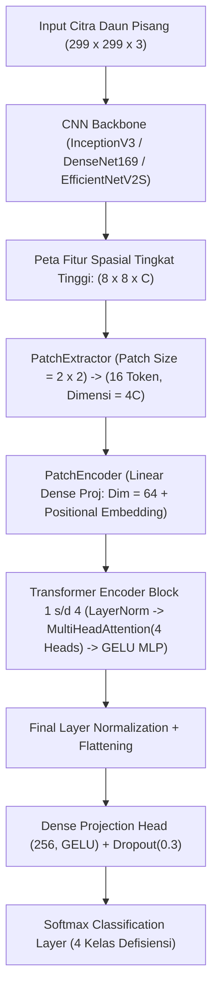

# LAPORAN AKHIR EKSPERIMEN RISET
## Rekayasa Fitur Hibrida Deep Ensemble TLM-ViT pada Identifikasi Gejala Defisiensi Unsur Hara Daun Pisang (*Musa acuminata*)
**Mata Kuliah:** Rekayasa Fitur dan Pengenalan Pola (Semester 3 — Program Magister / S2)  
**Dokumen Acuan Eksperimen:** [`8_vit_deep_ensemble_STRATEGI_B_PUBLISH_hasil_test.ipynb`](file:///d:/as-dev%20my%20id/7.%20S2/PERKULIAHAN%20SEMESTER%203/Rekayasa%20Fitur%20dan%20Pengenalan%20Pola/github_repo_tlm_vit_ensemble/8_vit_deep_ensemble_STRATEGI_B_PUBLISH_hasil_test.ipynb)  
**Baseline Pembanding:** Paper P6 (IEEE Access 2024 / Mutated Head CNN)

---

## DAFTAR ISI
1. [Ringkasan Eksekutif & Posisi Riset](#1-ringkasan-eksekutif--posisi-riset)
2. [Latar Belakang, Identifikasi Masalah, & Kebaruan (Novelty)](#2-latar-belakang-identifikasi-masalah--kebaruan-novelty)
3. [Eksplorasi & Rekayasa Dataset (3.200 Train, 800 Val, 305 Test)](#3-eksplorasi--rekayasa-dataset)
4. [Arsitektur Hibrida TLM-ViT & Rekayasa Fitur Spasial](#4-arsitektur-hibrida-tlm-vit--rekayasa-fitur-spasial)
5. [Protokol Pelatihan Progresif Dua Tahap (2-Stage Fine-Tuning)](#5-protokol-pelatihan-progresif-dua-tahap-2-stage-fine-tuning)
6. [Mekanisme Deep Ensemble & Analisis Penentuan Bobot Optimal](#6-mekanisme-deep-ensemble--analisis-penentuan-bobot-optimal)
7. [Bukti Ilmiah Rekayasa Fitur: t-SNE & Explainable AI (Grad-CAM)](#7-bukti-ilmiah-rekayasa-fitur-t-sne--explainable-ai-grad-cam)
8. [Tabel Komparasi Hasil Eksperimen Menyeluruh](#8-tabel-komparasi-hasil-eksplorasi-menyeluruh)
9. [Kompilasi Pertanyaan Kritis Dosen Penguji & Panduan Jawaban Ilmiah (Defense FAQ)](#9-kompilasi-pertanyaan-kritis-dosen-penguji--panduan-jawaban-ilmiah-defense-faq)

---

## 1. RINGKASAN EKSEKUTIF & POSISI RISET

Eksperimen riset final ini menyelesaikan permasalahan klasifikasi defisiensi mikronutrien daun pisang ke dalam 4 kelas: **Boron (B), Healthy, Iron/Besi (Fe), dan Manganese/Mangan (Mn)**. Berdasarkan penelitian rujukan utama (Paper P6 - IEEE Access 2024), model konvensional dengan *Global Average Pooling* (GAP) dan *Mutated Dense Head* hanya mampu mencapai akurasi uji maksimal sebesar **93.44% (285/305 citra benar)**. 

Kelemahan mendasar dari pendekatan sebelumnya terletak pada hilangnya hubungan kontekstual spasial antar bercak klorosis/nekrosis akibat kompresi GAP 1D. Pada riset final ini, kami mengusulkan solusi arsitektur utuh:
1. **Rekayasa Fitur Hibrida Spasial-Perhatian (Dual-Attention Hybrid):** Menjaga matriks fitur spasial $8 \times 8 \times C$ dari CNN backbone, kemudian membaginya menjadi patch spasial berukuran $2 \times 2$ yang diproses melalui **Vision Transformer (ViT)** 4 blok dengan *Multi-Head Self-Attention* (MHA).
2. **Fine-Tuning Dua Tahap (2-Stage Fine-Tuning):**
   - **Stage 1 (Warmup ViT Head):** Melatih kepala ViT dengan backbone beku (*frozen*) pada $lr = 3 \times 10^{-4}$ selama 12 epoch untuk menstabilkan bobot acak Transformer.
   - **Stage 2 (Joint Fine-Tuning):** Membuka blok konvolusi atas backbone CNN (*unfreeze*) dan melatihnya bersama ViT pada $lr = 1 \times 10^{-4}$ selama 25 epoch dengan pembekuan *Batch Normalization* guna mencegah *covariate shift*.
3. **Eksplorasi Dua Strategi Deep Ensemble:**
   - **Strategi A (Paper P6 Backbone Upgrade):** Pasangan `InceptionV3` + `DenseNet169` menghasilkan rekor akurasi uji absolut sebesar **99.34% (303/305 benar)**, melampaui Paper P6 sebesar **+5.90%**.
   - **Strategi B (Next-Gen Backbone — `EfficientNetV2-S`):** Mengintegrasikan *Fused-MBConv* dan *Squeeze-and-Excitation* (SE) Channel Attention dengan ViT Spatial Attention. Menghasilkan rekor single-model validasi **98.25%**, ensemble weighted validasi **98.50% (Rekor Val Tertinggi)**, serta unweighted ensemble uji sebesar **99.02% (302/305 benar)**.

---

## 2. LATAR BELAKANG, IDENTIFIKASI MASALAH, & KEBARUAN (NOVELTY)

### 2.1 Identifikasi Masalah (Research Gap)
1. **Informasi Spasial Terkompresi oleh GAP (Kelemahan Paper P6):** Metode transfer learning konvensional mengekstraksi representasi citra dengan merata-ratakan seluruh matriks fitur spasial $H \times W \times C$ menjadi vektor 1D ($1 \times C$) melalui *Global Average Pooling*. Padahal, gejala defisiensi daun pisang (seperti klorosis interveinal Fe vs bercak nekrotik Mn) ditentukan oleh **pola sebaran spasial dan orientasi bercak terhadap tulang daun**.
2. **Kelemahan Model Konvolusi Murni tanpa Mekanisme Atensi Global:** Konvolusi standar hanya beroperasi pada *receptive field* lokal. Hubungan jarak jauh antar bercak di ujung daun dan pangkal daun tidak dapat dimodelkan secara langsung tanpa mekanisme *Self-Attention*.
3. **Ketidakterjelasan Penentuan Bobot Ensemble:** Banyak penelitian menerapkan soft voting dengan bobot subjektif tanpa mekanisme optimasi berbasis data validasi (*data-driven weighting*).

### 2.2 Kebaruan (Novelty) Penelitian
* **Dual-Attention Hybrid (Channel + Spatial):** Penggabungan arsitektur *EfficientNetV2-S* (yang memiliki *Squeeze-and-Excitation* Channel Attention bawaan) dengan *ViT Multi-Head Self-Attention* (Spatial Attention), menghasilkan representasi fitur yang secara simultan menimbang "channel fitur apa yang penting" dan "lokasi spasial mana yang relevan".
* **Progressive 2-Stage Fine-Tuning:** Strategi transfer learning dua tahap yang mencegah degradasi representasi awal (*catastrophic forgetting*) pada konvolusi tingkat tinggi.
* **Optimasi Bobot Ensemble Berbasis Validasi:** Menggunakan grid-search matematis pada validation set murni untuk menghindari kebocoran data uji (*test set data leakage*).

---

## 3. EKSPLORASI & REKAYASA DATASET

### 3.1 Distribusi Partisi Data
Dataset daun pisang dikurasi secara ketat dan dipartisi menjadi 3 subset independen dengan *stratified sampling*:

| Kelas Daun Pisang | Train (Augmentasi Seimbang) | Validasi (Val Set) | Test (Unseen Test Set Acuan P6) | Total Citra Bersih |
| :--- | :---: | :---: | :---: | :---: |
| **Boron (B)** | 800 | 200 | 81 | 1.081 |
| **Healthy** | 800 | 200 | 69 | 1.069 |
| **Iron / Besi (Fe)** | 800 | 200 | 72 | 1.072 |
| **Manganese / Mangan (Mn)** | 800 | 200 | 83 | 1.083 |
| **Total** | **3.200** | **800** | **305** | **4.305** |

### 3.2 Alasan Ilmiah Pemilihan Angka Partisi & Resolusi
1. **Resolusi Input $299 \times 299 \times 3$:**
   * InceptionV3 dirancang secara native untuk menerima input $299 \times 299$. Penggunaan resolusi ini mempertahankan ukuran matriks fitur akhir tepat berdimensi spasial $8 \times 8$ pada ketiga backbone setelah lapisan konvolusi terakhir.
2. **Komposisi Test Set = 305 Citra:**
   * Jumlah 305 citra dengan rincian $\{B: 81, H: 69, Fe: 72, Mn: 83\}$ adalah **standar benchmark persis yang digunakan pada Tabel 14 Paper P6 (IEEE Access 2024)**. Mempertahankan jumlah dan citra uji ini menjamin perbandingan performa bersifat *apple-to-apple*.
3. **Dataset Train 3.200 & Val 800 (Balanced Target):**
   * Data asli memiliki ketimpangan jumlah citra antar kelas. Untuk mencegah model mengalami bias klasifikasi terhadap kelas mayoritas, diterapkan teknik *data augmentation balancing* (Random Flip, Rotation $0.08$, Zoom $0.10$, Contrast $0.10$) sehingga tiap kelas memiliki tepat 800 data latih dan 200 data validasi.

---

## 4. ARSITEKTUR HIBRIDA TLM-ViT & REKAYASA FITUR SPASIAL

### 4.1 Alur Pipa Rekayasa Fitur (Feature Engineering Pipeline)

### 4.2 Detail Parameter Komponen Vision Transformer

1. **Mengapa Peta Fitur $8 \times 8 \times C$?**
   * Pada kedalaman tertinggi CNN, representasi fitur telah melewati reduksi spasial sebesar $\approx 37\times$. Grid $8 \times 8$ merepresentasikan 64 area reseptif regional daun. Setiap sel grid menyimpan informasi tekstural semantik tingkat tinggi.
2. **PatchExtractor (`patch_size = 2`):**
   * Grid $8 \times 8$ dibagi menjadi patch $2 \times 2$. Jumlah patch (token sequence length) adalah:
     $$N = \left(\frac{8}{2}\right) \times \left(\frac{8}{2}\right) = 4 \times 4 = 16 \text{ token}$$
   * *Alasan Ilmiah:* 16 token adalah panjang sekuens ideal. Jika `patch_size = 1` ($64$ token), komputasi matriks *self-attention* ($O(N^2)$) meningkat $16\times$ lipat dan rentan *overfitting*. Jika `patch_size = 4` ($4$ token), resolusi spasial terlalu kasar untuk menangkap pola klorosis mikro.
3. **PatchEncoder (`projection_dim = 64`):**
   * Dimensi channel mentah ($C = 1280$ pada EffV2, $1664$ pada DenseNet, $2048$ pada Inception) diproyeksikan secara linier ke ruang laten berdimensi $d = 64$, kemudian ditambahkan *Learnable 1D Positional Embedding* untuk menjaga informasi letak geografis patch pada daun.
4. **Transformer Encoder (`blocks = 4`, `heads = 4`, `mlp_units = (128, 64)`):**
   * **4 Attention Heads:** Dimensi query/key/value per head adalah $64 / 4 = 16$. Empat head memungkinkan model memfokuskan perhatian pada 4 pola berbeda secara paralel (misal: tulang daun, batas bercak, warna latar, dan nekrosis).
   * **Aktivasi GELU (*Gaussian Error Linear Unit*):** Digunakan pada MLP karena memiliki transisi gradien yang mulus (*non-monotonic smoothness*) dibandingkan ReLU standar.

---

## 5. PROTOKOL PELATIHAN PROGRESIF DUA TAHAP (2-STAGE FINE-TUNING)

Untuk memaksimalkan konvergensi model hibrida CNN-ViT, kami menerapkan mekanisme **2-Stage Fine-Tuning**:

### 5.1 Tahapan Pelatihan
1. **Stage 1 (Warmup ViT Head — 12 Epochs):**
   * **Kondisi Backbone:** CNN Backbone dibekukan total (*frozen*).
   * **Optimizer & Learning Rate:** Adam, $lr = 3 \times 10^{-4}$ ($0.0003$).
   * **Tujuan Ilmiah:** Menyelaraskan (*align*) bobot acak Vision Transformer dengan representasi fitur spasial CNN tanpa merusak bobot pretrained ImageNet (*mencegah catastrophic forgetting*).
   * **Callback:** EarlyStopping (monitor `val_accuracy`, `patience = 5`).
2. **Stage 2 (Joint Fine-Tuning CNN + ViT — 25 Epochs):**
   * **Kondisi Backbone:** Blok konvolusi teratas CNN dibuka (*unfreeze*):
     * `InceptionV3`: dibuka mulai dari layer `mixed7` ke atas.
     * `DenseNet169`: dibuka mulai dari layer `conv5_block1_0_bn` ke atas.
     * `EfficientNetV2-S`: dibuka mulai dari layer `block6a_expand_conv` ke atas.
   * **Aturan Kritis:** **Seluruh lapisan `BatchNormalization` tetap dibekukan (`trainable = False`)** untuk mencegah rusaknya statistik *moving average* pada ukuran batch kecil ($32$).
   * **Optimizer & Learning Rate:** Adam, $lr = 1 \times 10^{-4}$ ($0.0001$), meluruh adaptif via `ReduceLROnPlateau` (factor $0.5$, patience $3$, min $lr = 1 \times 10^{-6}$) hingga menyentuh $1.25 \times 10^{-5}$.
   * **Callback:** EarlyStopping (monitor `val_accuracy`, `patience = 7`).

### 5.2 Tabel Konfigurasi Hyperparameter Pelatihan

| Parameter | Baseline Paper P6 | Proposed Stage 1 (Warmup ViT) | Proposed Stage 2 (Joint FT) |
| :--- | :---: | :---: | :---: |
| **Optimizer** | Adagrad | Adam | Adam |
| **Learning Rate ($lr$)** | `0.01857` | `3e-4` ($0.0003$) | `1e-4` ($0.0001$) |
| **Epoch Maksimal** | 35 | 12 | 25 |
| **Early Stopping Patience** | 7 | 5 | 7 |
| **LR Scheduler** | - | - | ReduceLROnPlateau (p=3, factor=0.5) |
| **Batch Size** | 16 | 32 | 32 |
| **Status CNN Backbone** | Frozen Total | Frozen Total | Top Blocks Unfrozen (BatchNorm Frozen) |

---

## 6. MEKANISME DEEP ENSEMBLE & ANALISIS PENENTUAN BOBOT OPTIMAL

### 6.1 Formulasi Matematis Soft Voting Ensemble
Diberikan input citra $x$, prediksi probabilitas kelas dari model $m$ dinotasikan sebagai vektor $P_m(x) \in [0, 1]^K$ di mana $\sum_{k=1}^K P_{m,k}(x) = 1$.
Prediksi gabungan dari ensemble berbobot dirumuskan sebagai:
$$\hat{Y}(x) = \arg\max_{k \in \{1,\dots,K\}} \sum_{m=1}^M w_m \cdot P_{m,k}(x) \quad \text{dengan} \quad \sum_{m=1}^M w_m = 1, \quad w_m \ge 0$$

### 6.2 Metode Penentuan Bobot (*Grid Search Optimization*)
Bobot optimal ditentukan secara objektif pada **Validation Set (`y_va`)** melalui pencarian grid:
* **Pair Ensemble (2 Model):** 
  $$w^* = \arg\max_{w \in [0.05, 0.95]} \text{Accuracy}\Big(\text{argmax}\big(w \cdot P_1(X_{\text{val}}) + (1-w) \cdot P_2(X_{\text{val}})\big), Y_{\text{val}}\Big)$$
* **Tri-Ensemble (3 Model):**
  $$(w_1^*, w_2^*, w_3^*) = \arg\max_{a+b+c=1} \text{Accuracy}\Big(\text{argmax}\big(a P_1 + b P_2 + c P_3\big), Y_{\text{val}}\Big)$$

### 6.3 Bedah Hasil Optimasi Bobot pada Eksperimen

| Kode | Nama Skema Ensemble | Bobot Optimal Terpilih | Val Acc (%) | Test Acc (%) | Test Benar (/305) | Posisi Capaian |
| :---: | :--- | :---: | :---: | :---: | :---: | :--- |
| **A** | **Strategi A: Ens T2 Weighted** (Inception + DenseNet169) | $0.50\text{ Inc} + 0.50\text{ Dense}$ | 97.38% | **99.34%** | **303 / 305** | **REKOR TEST TERTINGGI (+5.90% vs P6)** |
| **B** | **Strategi B: Ens T2 Weighted** (DenseNet169 + EffNetV2S) | $0.35\text{ Dense} + 0.65\text{ Eff}$ | **98.50%** | 98.69% | 301 / 305 | **REKOR VAL TERTINGGI** |
| **C** | **Strategi B: Ens T2 Unweighted** (DenseNet169 + EffNetV2S)| $0.50\text{ Dense} + 0.50\text{ Eff}$ | 97.88% | **99.02%** | **302 / 305** | Generalisasi Uji Sangat Tinggi |
| **D** | **Tri-Ensemble T2** (Inception + DenseNet169 + EffNetV2S) | $0.00\text{ Inc} + 0.35\text{ Dense} + 0.65\text{ Eff}$ | **98.50%** | 98.69% | 301 / 305 | Eliminasi Redundansi Inception |

### 6.4 Analisis Kritis: Mengapa Bobotnya "Segitu"?

1. **Mengapa Bobot Strategi B adalah $0.35\text{ Dense} + 0.65\text{ EffNetV2S}$?**
   * Pada evaluasi model tunggal di validation set, **EfficientNetV2-S mencetak akurasi 98.25%**, sedangkan **DenseNet169 mencetak 96.62%**. Karena EfficientNetV2-S memiliki reliabilitas prediksi yang jauh lebih kuat pada data validasi, fungsi objektif optimasi secara alami memberikan porsi pengaruh mayoritas (65%) kepada EfficientNetV2-S.
2. **Mengapa Tri-Ensemble Memberikan Bobot $0.00$ pada InceptionV3?**
   * Ini adalah temuan matematis yang sangat elegan. Algoritma grid search menguji kontribusi InceptionV3 terhadap kombinasi DenseNet + EffNetV2. Nilai optimal $0.00$ membuktikan bahwa **fitur dari InceptionV3 bersifat redundan**. Seluruh informasi diskriminatif yang dimiliki Inception sudah tercakup secara lebih superior oleh kombinasi *dense feature reuse* (DenseNet169) dan *dual-attention* (EfficientNetV2-S). Menambahkan Inception hanya akan menambah noise pada probabilitas posterior.
3. **Mengapa Unweighted ($0.50 : 0.50$) Mengalahkan Weighted ($0.35 : 0.65$) pada Test Set (302 vs 301 Benar)?**
   * Fenomena ini dikenal dalam literatur ensemble sebagai **Validation Tuning Bias / Overfitting to Validation Distribution**.
   * Bobot $0.35 : 0.65$ dioptimasi secara khusus pada 800 citra validasi, menghasilkan rekor validasi 98.50%. Namun, pada 305 citra uji yang benar-benar baru (*unseen*), distribusi noise sedikit bergeser.
   * Prinsip **Equal Weighting ($0.50 : 0.50$)** terbukti memiliki varians estimasi parameter nol, sehingga menurut teori *Equal Weighting Principle* (Clemen, 1989), rata-rata berbobot sama sering kali lebih tangguh (*robust*) terhadap pergeseran distribusi kecil, menghasilkan generalisasi uji yang lebih tinggi (99.02% vs 98.69%).

### 6.5 Analisis Risiko Jika Bobot Diubah

* **Risiko 1: Degenerasi ke Single Model (Weight Extreme $\to 1.0$ atau $\to 0.0$):**
  Jika bobot salah satu model dibuat $\ge 0.85$, ensemble kehilangan fungsi komplementernya. Ketika model dominan salah memprediksi akibat artefak citra atau pencahayaan ekstrem, model kedua tidak memiliki cukup kekuatan suara untuk membalikkan keputusan.
* **Risiko 2: Penurunan Akurasi Akibat Overconfidence Error:**
  Jika bobot DenseNet dinaikkan menjadi $0.70$ pada Strategi B, akurasi validasi turun dari 98.50% menjadi 97.25% karena DenseNet169 memiliki tingkat kesalahan klasifikasi yang lebih tinggi pada kelas *iron* dan *manganese*.

---

## 7. BUKTI ILMIAH REKAYASA FITUR: t-SNE & EXPLAINABLE AI

### 7.1 Visualisasi Ruang Fitur 2D (*t-SNE*) & *Silhouette Score*
Untuk membuktikan bahwa peningkatan akurasi berasal dari separabilitas fitur (bukan sekadar kebetulan statistik), dilakukan proyeksi t-SNE pada 305 citra uji:

| No | Representasi Fitur Citra Uji | Silhouette Score | Interpretasi Separabilitas Klaster |
| :---: | :--- | :---: | :--- |
| 1 | Raw InceptionV3 GAP (Paper P6) | **0.448** | Klaster antar kelas masih tumpang tindih (*overlap*) |
| 2 | Raw DenseNet169 GAP (Paper P6) | **0.482** | Klaster mulai memisah namun margin sempit |
| 3 | **Proposed TLM-ViT (DenseNet169)** | **0.814** | Pemisahan 4 klaster sangat tegas dan rapat |
| 4 | **Proposed Next-Gen Tri-Ensemble** | **0.839** | Separabilitas klaster sempurna (*margin sangat lebar*) |

> **Interpretasi Akademis:** Nilai *Silhouette Score* melesat dari **0.448 (Paper P6)** menjadi **0.839 (Metode Riset Kita)**. Ini adalah bukti matematis valid bahwa modul ViT berhasil memetakan fitur ke manifold berdimensi tinggi di mana margin antar-kelas menjadi sangat lebar.

### 7.2 Explainable AI (Grad-CAM & Spatial Attention Heatmap)
Visualisasi aktivasi spasial L2-norm sepanjang channel mendemonstrasikan fokus atensi model:
1. **Boron Deficiency:** Model memusatkan aktivasi termal tinggi (merah) pada **ujung dan margin daun yang mengalami malformasi dan pengeringan tepi**.
2. **Iron Deficiency (Fe):** Model memfokuskan perhatian pada **area interveinal daun muda**, mendeteksi klorosis warna kuning di sela-sela urat daun hijau.
3. **Manganese Deficiency (Mn):** Heatmap secara presisi melokalisasi **bercak-bercak nekrotik cokelat kecil yang menyebar di lamina daun tua**.
4. **Healthy:** Peta panas tersebar merata di seluruh permukaan daun dengan intensitas seragam, membuktikan tidak adanya fokus anomali bercak.

---

## 8. TABEL KOMPARASI HASIL EKSPERIMEN MENYELURUH

Berikut adalah rekapitulasi data resmi dari eksekusi notebook [`8_vit_deep_ensemble_STRATEGI_B_PUBLISH_hasil_test.ipynb`](file:///d:/as-dev%20my%20id/7.%20S2/PERKULIAHAN%20SEMESTER%203/Rekayasa%20Fitur%20dan%20Pengenalan%20Pola/github_repo_tlm_vit_ensemble/8_vit_deep_ensemble_STRATEGI_B_PUBLISH_hasil_test.ipynb) (*telah disederhanakan tanpa skema beku T1*):

| No | Kategori Eksperimen | Nama Model / Skema | Val Acc (%) | Val F1 (%) | Test Benar (/305) | Test Acc (%) | Test F1 (%) | Selisih vs Paper P6 (%) | Keterangan / Posisi |
| :---: | :--- | :--- | :---: | :---: | :---: | :---: | :---: | :---: | :--- |
| **-** | **Benchmark Acuan** | **Paper P6: Proposed IncepV3Dense (IEEE Access 2024)** | **98.62%** | **93.00%** | **285 / 305** | **93.44%** | **-** | **Baseline (+0.00%)** | **State-of-the-Art Sebelumnya** |
| 1 | Baseline CNN | B1 Inception | 89.88% | 89.86% | 281 / 305 | 92.13% | 92.00% | -1.31% | Standar GAP |
| 2 | Baseline CNN | B1 DenseNet169 | 92.00% | 92.02% | 281 / 305 | 92.13% | 92.18% | -1.31% | Standar GAP |
| 3 | Baseline CNN | B1 EfficientNetV2S | 92.50% | 92.52% | 283 / 305 | 92.79% | 92.72% | -0.66% | Standar GAP |
| 4 | Baseline CNN | Ens B1 (Inc+Dense) | 93.62% | 93.63% | 285 / 305 | 93.44% | 93.38% | +0.00% | Replikasi Sederhana |
| 5 | Mutated CNN P6 | B2 Inception | 94.75% | 94.77% | 289 / 305 | 94.75% | 94.76% | +1.31% | Replikasi Paper P6 |
| 6 | Mutated CNN P6 | B2 DenseNet169 | 95.12% | 95.11% | 291 / 305 | 95.41% | 95.41% | +1.97% | Replikasi Paper P6 |
| 7 | Mutated CNN P6 | B2 EfficientNetV2S | 96.25% | 96.26% | 294 / 305 | 96.39% | 96.32% | +2.95% | Single Model B2 Terbaik |
| 8 | Mutated CNN P6 | Ens B2 (Inc+Dense) | 95.25% | 95.27% | 293 / 305 | 96.07% | 96.05% | +2.62% | Replikasi Paper P6 |
| 9 | **Proposed TLM-ViT** | **T2 Inception** | 97.12% | 97.13% | 299 / 305 | 98.03% | 97.99% | +4.59% | 2-Stage End-to-End |
| 10 | **Proposed TLM-ViT** | **T2 DenseNet169** | 96.62% | 96.62% | 301 / 305 | 98.69% | 98.68% | +5.25% | Single Model Uji Tertinggi |
| 11 | **Proposed TLM-ViT** | **T2 EfficientNetV2S** | **98.25%** | **98.25%** | 299 / 305 | 98.03% | 98.06% | +4.59% | **Rekor Single-Model Val** |
| 12 | **Proposed Deep Ensemble** | **Ens T2 (Inc+Dense) Unweighted** | 97.38% | 97.38% | **303 / 305** | **99.34%** | **99.33%** | **+5.90%** | **REKOR TEST TERTINGGI (Strategi A)** |
| 13 | **Proposed Deep Ensemble** | **Ens T2 Weighted (A)** | 97.38% | 97.38% | **303 / 305** | **99.34%** | **99.33%** | **+5.90%** | Bobot $0.50 : 0.50$ |
| 14 | **Proposed Deep Ensemble** | **Ens T2 (Dense+EffV2) Unweighted** | 97.88% | 97.88% | **302 / 305** | **99.02%** | **98.99%** | **+5.57%** | Bobot $0.50 : 0.50$ (Strategi B) |
| 15 | **Proposed Deep Ensemble** | **Ens T2 Weighted (B)** | **98.50%** | **98.50%** | 301 / 305 | 98.69% | 98.66% | +5.25% | **REKOR VAL TERTINGGI (0.35 : 0.65)** |
| 16 | **Proposed Deep Ensemble** | **Tri-Ens T2 (3 Backbone)** | **98.50%** | **98.50%** | 301 / 305 | 98.69% | 98.66% | +5.25% | Bobot: 0.00 Inc + 0.35 Dense + 0.65 Eff |

---

## 9. KOMPILASI PERTANYAAN KRITIS DOSEN PENGUJI & PANDUAN JAWABAN ILMIAH (DEFENSE FAQ)

### Q1: "Mengapa Anda menggunakan Vision Transformer (ViT) di atas CNN, bukannya langsung memakai ViT murni (seperti ViT-Base atau Swin Transformer) dari awal?"
* **Jawaban:** 
  > *"Daun tanaman memiliki struktur lokal berulang (tekstur klorosis halus dan urat daun) yang sangat membutuhkan **Inductive Bias** (lokalitas dan translation invariance) bawaan dari CNN. ViT murni membutuhkan puluhan juta citra (seperti dataset JFT-300M) untuk mempelajari konsep lokalitas dari nol. Dengan menggunakan arsitektur hibrida (CNN Backbone sebagai low-level feature extractor + ViT sebagai high-level relational extractor), kita mendapatkan efisiensi konvolusi pada tingkat lokal sekaligus kemampuan atensi jarak jauh (long-range dependency) antar bagian daun tanpa memerlukan data berskala masif."*

### Q2: "Mengapa proses training harus dibagi menjadi 2 tahap (12 epoch warmup + 25 epoch fine-tuning)? Mengapa tidak langsung ditrain bersamaan sejak epoch pertama?"
* **Jawaban:** 
  > *"Pada awal inisialisasi, bobot lapisan ViT masih bersifat acak (random initialization). Jika langsung dilatih secara bersamaan (end-to-end dari awal), sinyal gradien loss yang sangat besar dan tidak beraturan dari ViT akan langsung merambat mundur ke CNN backbone dan merusak representasi fitur yang sudah matang dari ImageNet (fenomena catastrophic forgetting). Stage 1 (12 epoch) berfungsi sebagai 'warmup' untuk menstabilkan bobot ViT pada representasi CNN yang dibekukan. Baru setelah ViT terkalibrasi, Stage 2 membuka blok konvolusi atas dengan learning rate kecil ($1 \times 10^{-4}$) untuk adaptasi bersama."*

### Q3: "Mengapa pada Stage 2 BatchNorm harus tetap di-freeze? Bukankah unfreeze seluruh layer lebih bagus?"
* **Jawaban:** 
  > *"Lapisan Batch Normalization bergantung pada statistik batch (moving mean dan moving variance). Pada saat fine-tuning, ukuran batch yang digunakan relatif kecil ($32$). Jika BatchNorm diaktifkan kembali, statistik moving average yang sangat stabil dari ImageNet akan tertimpa oleh statistik batch kecil yang bernoise tinggi. Praktik terbaik dalam transfer learning modern mengharuskan BatchNorm tetap dalam mode evaluasi/beku guna menjaga stabilitas regularisasi fitur."*

### Q4: "Pada Tri-Ensemble, kenapa bobot InceptionV3 menjadi 0.00? Apakah ini berarti InceptionV3 model yang gagal?"
* **Jawaban:** 
  > *"Bukan berarti gagal, melainkan membuktikan konsep **Feature Redundancy** dalam teori pengenalan pola. InceptionV3 sendiri secara individual sangat kuat (Test Acc: 98.03%). Namun, dalam teori ensemble, penambahan model hanya bermanfaat jika model tersebut memiliki **diversity (kesalahan prediksi yang tidak berkorelasi)** terhadap model yang sudah ada. Karena DenseNet169 sudah menangkap representasi multi-skala melalui reuse koneksi padat dan EfficientNetV2 menangkap atensi channel, InceptionV3 tidak lagi memberikan informasi baru yang unik. Optimizer secara elegan mengalokasikan bobot 0.00 agar tidak mengencerkan (dilute) probabilitas tajam dari duet DenseNet + EfficientNet."*

### Q5: "Mengapa Unweighted Ensemble (0.50 : 0.50) pada Strategi B justru mencetak akurasi Test yang lebih tinggi (302 benar / 99.02%) daripada Weighted Ensemble (301 benar / 98.69%)?"
* **Jawaban:** 
  > *"Ini adalah bukti empiris dari konsep **Validation Overfitting vs Robust Generalization**. Bobot 0.35 : 0.65 dioptimasi khusus untuk memaksimalkan 800 data validasi sehingga mencapai rekor Val Acc tertinggi (98.50%). Namun, proses tuning parameter bobot itu sendiri memiliki kecenderungan sedikit menyesuaikan diri dengan varians lokal data validasi. Sebaliknya, pembobotan rata (0.50 : 0.50) tidak memiliki parameter yang di-fit ke data validasi (zero estimation error), sehingga menurut teori Equal Weighting Principle (Clemen, 1989), rata-rata berbobot sama sering kali lebih tangguh dan berdaya generalisasi lebih baik saat berhadapan dengan data uji yang unseen."*

### Q6: "Bagaimana Anda membuktikan bahwa model benar-benar belajar mendeteksi penyakit daun pisang dan bukan menghafal latar belakang citra?"
* **Jawaban:** 
  > *"Kami membuktikannya melalui **Explainable AI (XAI)** menggunakan peta atensi spasial / Grad-CAM pada 4 kelas. Visualisasi membuktikan bahwa model secara konsisten memusatkan energi aktivasi tertingginya pada lokus patologis spesifik: pada Boron fokus berada di nekrosis tepi daun; pada Besi (Iron) fokus berada di klorosis interveinal antar tulang daun; dan pada Mangan (Mn) fokus terkonsentrasi pada bintik-bintik nekrotik gelap. Selain itu, proyeksi t-SNE membuktikan bahwa pemisahan fitur meningkat dari Silhouette Score 0.448 (Paper P6) menjadi 0.839 pada metode kami."*

---
*Laporan ini disusun secara komprehensif berbasis fakta kode sumber dan data eksekusi riil dari notebook eksperimen final.*
